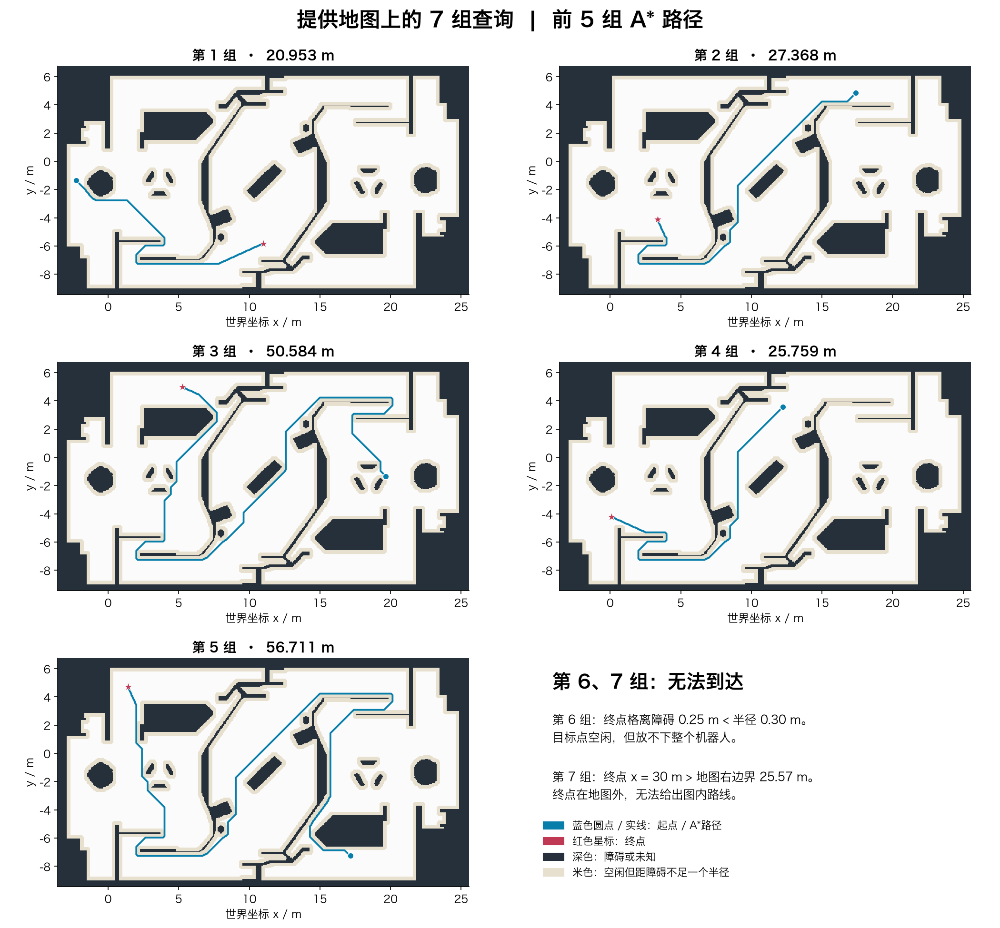

# MountainForge 视觉组招新考核

本仓库汇总我的考核代码、实验结果和报告。方向题选择 **B 题：环境建图与路径规划**。各题的详细过程和问题回答保留在对应文件夹，本文主要说明完成情况和主要结果。

## 一、完成情况一览

| 部分 | 完成内容 | 材料位置 |
|---|---|---|
| 题一：开发环境与工程规范 | 配置 Python 3.11.17 和基础依赖，使用 Git 管理代码并分阶段提交 | [环境截图](./q1_env%3A/) |
| 题二：相机标定与单目测距 | 完成相机标定、去畸变、两组 A4 测距及部分对照实验；测距数量和范围尚未达到全部要求 | [题二报告](./q2_calib/题二提交文档.docx) |
| B 题：环境建图与路径规划 | 完成点云处理、栅格建图、A* 与 Dijkstra、七组查询分析，以及地形分析、算法比较和决策仿真 | [B 题报告](./qB_sentry/README.md) |
| 附加题一 | 完成数字分类网络训练、ONNX 导出和 CPU 推理速度对比 | [实验代码与结果](./extra/q1/) |
| 附加题二、三 | 完成 ARM/x86、NPU/GPU 对比，以及自瞄命中率影响因素分析 | [附加题报告](./extra/附加题文档.docx) |

A 题未选做；Ubuntu 加分项和附加题四未列入本次已完成内容。

## 二、各题方案与结果

### 题一：开发环境

使用 Miniconda 创建 `rmvision` 环境，安装 NumPy、OpenCV、Matplotlib、PyYAML 等基础库。B 题使用 Open3D 处理点云，数字分类实验使用 PyTorch 和 ONNX Runtime。仓库按题目分别保存代码、文档和结果。

### 题二：相机标定与单目测距

使用 Mac 内置摄像头和屏幕显示的棋盘格采集图像，实测方格边长为 19.4 mm。25 张图像中有 23 张完整检出角点，用 OpenCV 求出内参、畸变系数并生成去畸变对比图。整体重投影 RMS 为 **0.260 像素**。

测距时手动标注 A4 纸四角，以标准纸张尺寸建立物点坐标，通过 `solvePnP` 求出相机到纸张中心的距离。

| 参考距离 | 照片数量 | 平均测距结果 | 平均偏差 |
|---|---:|---:|---:|
| 0.630 m | 3 张 | 0.6134 m | −16.56 mm |
| 0.891 m | 3 张 | 0.9291 m | +38.13 mm |

参考距离由 A4 纸边长分段量取，存在量取误差，不能当作高精度真值。本次仅完成两组近距离验证，尚未完成至少五组、约 0.5～3 m 的验证，以及同距离不同角度和独立全正对标定组的实测对照。

完成了固定五张图像标定和错误方格尺寸两项计算对照。五张组拟合误差更低，不代表标定更准确；统一缩小棋盘格尺寸主要改变标定外参的长度尺度，后续使用正确 A4 尺寸时，测距结果并未同比缩小。

问题回答要点：`fx`、`fy` 是像素单位的焦距，`cx`、`cy` 是主点坐标；像素近似正方形时，`fx` 与 `fy` 通常接近。重投影误差衡量图像上的拟合偏差，不能直接等同于实际测距误差。标定曲线、去畸变对比和测距图表见[题二报告](./q2_calib/题二提交文档.docx)。

### B 题：环境建图与路径规划

使用 Open3D 对约 212 万点的点云进行降采样、离群点剔除和多平面拟合，识别地面并调平。结合局部支撑面、坡度、台阶和车身净空，生成分辨率为 **0.05 m** 的栅格地图。

路径规划手写 A* 和 Dijkstra，考虑机器人 **0.30 m** 半径、未知区域和斜向穿角限制，再用题目检查器验证路径。

- 给定地图：第 1～5 组两种算法共 **10 条路径通过检查**；第 6 组终点离障碍过近，第 7 组终点位于地图外，判为不可达。
- 自建地图：第 1、2、3、5 组共 **8 条路径通过检查**；第 4 组受起点附近未知区域限制，第 6、7 组仍不可达。
- 发挥部分：完成坡道与台阶分析、异常点处理、地图对正、搜索过程可视化、启发函数实验，以及考虑血量、弹量、敌方位置、剩余时间和前哨站状态的有限状态机仿真。

问题回答要点：最大拟合平面可能是墙，需结合方向和高度判断地面；多层场地不能仅靠统一高度阈值判断障碍；八邻域下曼哈顿距离可能高估，增大启发函数也不保证更快或保持最优。异常物的成因仍属于推测，自建地图也保留了未观测区域。

详细回答见 [B 题报告](./qB_sentry/README.md)，路径长度、耗时和不可达原因见[汇总表](./qB_sentry/汇总表.md)。

### 附加题

数字分类使用公开数据中的数字 1～5，训练小型卷积网络并导出 ONNX。测试集准确率为 **99.06%（950/959）**，PyTorch 与 ONNX Runtime 的预测类别一致率为 **100%**。本机单线程、单张输入下，两者中位延迟分别约为 **0.1005 ms** 和 **0.0246 ms**。这些结果仅代表本次数据划分和测试配置，尚未进行独立场景验证。

附加题二比较了处理器架构和推理硬件，附加题三分析了识别、标定、时间同步、预测及执行机构对自瞄命中率的共同影响。具体内容见[附加题报告](./extra/附加题文档.docx)，另附[训练曲线](./extra/q1/results/training.png)和[混淆矩阵](./extra/q1/results/confusion.png)。

## 三、问题记录

| 遇到的问题 | 处理方法 |
|---|---|
| 屏幕棋盘格的显示尺寸发生变化 | 重新测量格长并采集正式标定图像，不混用试拍组 |
| 测距缺少卷尺真值，样本数量不足 | 明确记录参考距离的来源、偏差和未完成范围 |
| 点云最大平面被误认为地面 | 连续提取候选平面，结合安装高度、法向和残差判断 |
| 稀疏点云产生假空洞，影响规划 | 调整观测规则，采用局部滤波和有条件补孔，保留无依据的未知区 |
| 空闲格不一定容得下机器人 | 增加半径安全区、端点及完整路径线段检查 |
| 检查器输出“没通过”也包含“通过” | 要求最后一行严格等于“通过”，同时保存原始日志 |

## 四、学习总结

在拿到题目后我先读了一遍理解题意 然后让ai把题目拆分成了几块知识点进行一定的复习 对于没有学过的知识点进行简单的了解学习（包括A\* 与 Dijkstra 地图处理等）后续视觉任务中我还有很多需要学习的 我也将会借助ai的解答与资料进行学习与研发实践