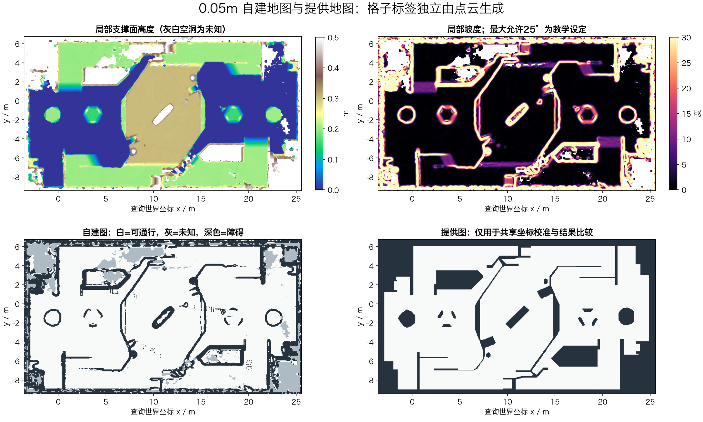
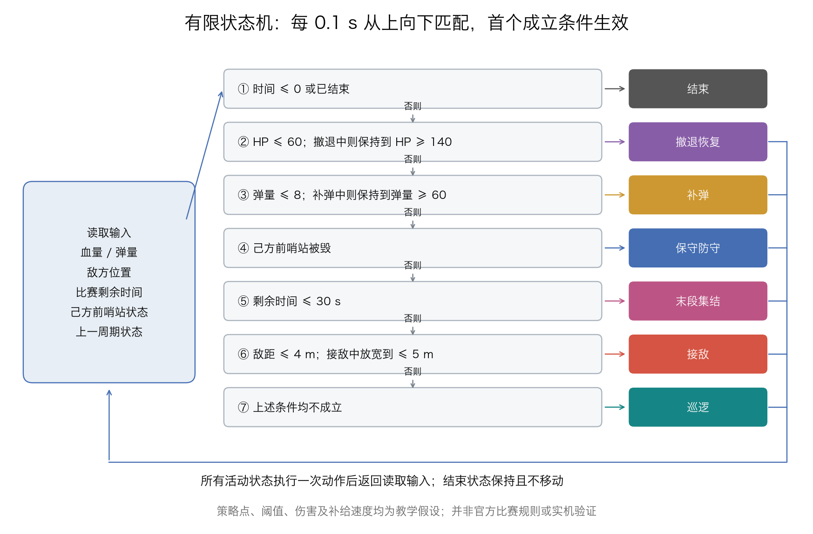

# B 题：环境建图与路径规划

本项目完成点云处理、可通行区域地图生成、A*与Dijkstra路径规划，并开展启发函数对比和哨兵决策二维仿真。

## 1. 实现内容

| 要求 | 实现与实际结果 | 主要证据 |
|---|---|---|
| 点云读取、降采样、离群点剔除 | Open3D读取2116092点，4cm体素降到1348758点，统计滤波后1338564点 | `代码/build_cloud_map.py`、`点云处理图/preprocessing.json` |
| 地面识别与调平 | 首次最大平面是墙；第5个候选满足地面高度与法向条件，调平后地面残差95%约1.4cm | `点云处理图/01_点云处理过程.png` |
| 0.05m栅格地图 | 局部支撑面、坡度、台阶、车身净空联合分类，导出PGM/PNG/YAML | `地图/cloud_map.*` |
| 手写A*和Dijkstra、7组查询 | 给定图第1～5组两种算法共10条路径通过；第6、7组给出不可达原因 | 根目录`path1.csv`～`path5.csv`、`unreachable.json` |
| 坡道与台阶区分 | 合成地形验证，真实剖面8处坡道、4处不可跨越边缘验证 | `检查结果/地形验证.json`、实际剖面图 |
| 异常物分析与处理 | 剔除散点、地下和场外异常；定位约18.5m高矩形围挡候选，地形生成忽略高处围挡、保留近地截面 | `点云处理图/anomaly_analysis.json`、异常诊断图 |
| 地图旋转对正 | 从边界平面构造正交坐标轴；保留原生图和共享查询坐标图 | `地图/coordinate_transform.json` |
| 搜索过程与性能比较 | 实际扩展顺序、PNG和GIF，记录扩展数、长度和耗时 | `补充结果/给定地图规划/` |
| 自建图规划及比较 | 第1、2、3、5组两种算法共8条路径通过；其余逐组说明 | `补充结果/自建地图规划/summary.md` |
| 哨兵决策与仿真 | FSM考虑全部5类输入；6个情景、3056步、全部7状态覆盖 | `补充结果/决策仿真/` |
| 启发函数变体实验 | 欧氏、曼哈顿、2倍欧氏的全部查询，20条可达实验路径均通过 | `补充结果/启发函数实验/` |

**证据范围：** 异常物几何已定位并处理，但“仿真空气墙/噪声/配准误差”等成因只能作为推测。没有对象标注或仿真源文件，无法证明某个实体语义上一定不应存在。最大允许坡度25°为建图参数假设。自建图第4组受未知区影响，不能声称本地图已完整恢复场地。

## 2. 整体方案

```text
原始 PCD
  → 有限值检查、4cm体素降采样、统计离群点剔除
  → 多平面RANSAC、地面候选复核、边界轴与水平坐标变换
  → 地下/场外异常处理，保留可审计的原始数据
  → 每格局部支撑高度、坡度、12cm台阶、60cm车身空间
  → 5cm自建栅格图（可通行 / 不可通行 / 未知）
  → 共享坐标校准、同一组查询、自建图规划比较

提供 PGM + YAML + queries.json
  → 灰度分类、世界/像素转换、半径30cm安全区
  → 端点检查、手写Dijkstra/A*、世界坐标CSV
  → 端点/间距/完整线段检查 + 原check_path.py
  → 搜索动画、统计、启发函数变体

血量 + 弹量 + 敌方位置 + 剩余时间 + 前哨站状态
  → 有优先级和滞回的FSM → 策略目标 → 同一个A* → 二维仿真
```

提供图没有被当作点云建图的标签来源，只用于比较和二维平移配准；原生点云图可单独查看。规划算法仅使用heapq管理队列，没有调用现成路径规划库。

## 3. 结果

| 查询 | 提供图：A*/Dijkstra长度 / m | 自建图：A*/Dijkstra长度 / m | 说明 |
|---|---:|---:|---|
| 1 | 20.953 / 20.953 | 20.836 / 20.836 | 均通过各自地图的检查 |
| 2 | 27.368 / 27.368 | 29.944 / 29.944 | 自建图需要更多绕行 |
| 3 | 50.584 / 50.584 | 52.036 / 52.036 | 自建图需要更多绕行 |
| 4 | 25.759 / 25.759 | 无法到达 | 起点距自建图未知格仅0.15m，机器人半径0.30m |
| 5 | 56.711 / 56.711 | 59.884 / 59.884 | 自建图需要更多绕行 |
| 6 | 无法到达 | 无法到达 | 提供图终点距障碍0.25m；自建图距障碍0.15m，均不足半径 |
| 7 | 无法到达 | 无法到达 | 终点x=30m超过地图右边界25.57m |

长度为最终CSV折线长度，包含真实端点与格子中心的连接；最短性只针对设定的安全八邻域图。路径点距最大约0.070711m，符合≤0.15m。第6、7组的不可达原因记录在`unreachable.json`。




自建图可通行135764格、未知16159格、不可通行36969格。与提供图可通行标签IoU约0.836；由于参考图不是人工真值，该数值不是准确率。

自建图第1组较短不代表算法更优秀；输入的地形和障碍边界不同。第4组则说明稀疏观测对保守规划有影响。两张图的比较必须同时说明可达性、长度和地图差异。

## 4. 题目六问的回答

### ① 首次地面拟合得到的是地面吗？如何判断？

不是。本次首次RANSAC最大平面的归一化法向约为`[-0.92468,-0.04759,0.37775]`，相对于由正交边界墙推得的竖直方向接近90°，是竖直墙面。它的支持点最多，并不意味着它是地面。

最终地面候选出现在第5个主要平面，其方程约为`0.37457x+0.06470y+0.92494z+0.41927=0`，距离雷达原点约0.419m，符合约0.4m的安装高度；法向与墙法向叉积得到的向上方向相符，调平后覆盖大范围最低地面，95%残差约1.4cm。综合法向、传感器高度、覆盖范围和多层结构判断，而不是只看点数。

### ② 为什么不能只用“高度大于某值”判断障碍？

因为场地有不同高度的可行驶平面和坡道。例如0.30m高地的顶面可通行，机器人可经坡道到达，但不能从20cm或30cm高的垂直边缘跨上去。

判断要相对于局部支撑面：相邻高度跳变是否超过0.12m、坡面是否连续且坡度可接受、支撑面上方0.60m车身空间是否被占用、是否存在未观测区域。全局高度阈值无法区分高地顶面、坡道、台阶和悬空结构。

### ③ 首次运行check_path.py是否通过？若未通过如何改进？

在提供地图上，首次完整规划后生成的前5组两种算法共10条路径均通过；原始标准输出保存在`检查结果/checker_logs/`。此前第一步的端点探针不是完整路径，不能将其算作首次完整规划验证。第6、7组在预检中判为不可达，未生成路径文件。

通过的关键是先考虑0.30m半径膨胀、未知区域禁行、禁止斜穿角、正确转换坐标、保留真实端点和保证点距。本项目还补充了原检查器没有覆盖的完整线段与端点检查。

自建地图初版曾因过严的“每格至少2个点”规则产生大量假空洞，导致无法生成路线；这属于建图过于保守，不是已生成路径检查失败。经过观测密度分析、局部滤波和限定补孔后，当前自建图有4组原始任务可达，共8条路径通过；第4组仍保留未知区限制。


该图根据检查器的实际标准输出排版，原始日志一并保存。

### ④ 曼哈顿距离或2倍启发函数有什么变化？

八邻域斜走一格真实成本为`0.05*sqrt(2)≈0.07071m`，曼哈顿距离却给`0.10m`，会高估；它不再满足当前最短路保证。4邻域且边长一致时，曼哈顿距离才是相应的合适选择。

实验在相同图与规则上运行欧氏、曼哈顿、2倍欧氏，并允许更优g重新打开节点，避免把不一致启发函数与不可重开实现混淆。重开并不能消除高估带来的次优风险。

| 查询 | 欧氏/基准长度m | 曼哈顿长度m | 2倍欧氏长度m |
|---|---:|---:|---:|
| 1 | 20.953 | 20.953 | 20.953 |
| 2 | 27.368 | 27.368 | 27.368 |
| 3 | 50.584 | 50.584 | 50.759 |
| 4 | 25.759 | 25.759 | 25.759 |
| 5 | 56.711 | 56.711 | 56.887 |

本次曼哈顿碰巧仍得到同样长度，不能证明它总是最优。2倍欧氏在第3、5组产生更长路线，而且第1组总扩展257548次，其中234213次为重复扩展，超过Dijkstra的44861次。不能简单写成“乘2一定更快”。若禁止重开，工作量和路线又可能不同，必须说明实现策略。

计时、唯一扩展节点数、重开次数和最优比分别记录在`补充结果/启发函数实验/summary.md`。耗时会受后台负载影响，不把单次数字作为固定性能承诺。

### ⑤ YAML中的四个参数是什么意思？

| 参数 | 含义 | 本题值 |
|---|---|---|
| `origin` | 地图在世界坐标中的平面位姿：左下角x、y及偏航角yaw（弧度） | `[-3.58,-9.44,0]` |
| `resolution` | 每个栅格边长，单位m/格 | `0.05` |
| `occupied_thresh` | 占据值高于此阈值归为占据 | `0.65` |
| `free_thresh` | 占据值低于此阈值归为空闲 | `0.25` |

在`negate=0`时，占据值`p=(255-gray)/255`，因此黑色占据值高、白色低；位于两个阈值之间（含边界）的格子为未知。新地图用灰度127表示未知，不能误用205：在本配置下205对应约0.196，会被判为空闲。

图像行号向下增加，世界y向上增加，转换时必须翻转：`row=height-1-floor((y-origin_y)/resolution)`。原检查器忽略非零yaw与negate，本项目明确限制输入为本题的yaw=0、negate=0；自建图在三维阶段对正后再导出yaw=0。地图编码约定可核对 [Nav2 map_io源码](https://api.nav2.org/nav2-rolling/html/map__io_8cpp_source.html)。

### ⑥ FSM、行为树各适合什么？小型LLM的优势与风险？

FSM适合状态数量少、转移条件清晰、需要穷举验证的策略。本项目的巡逻、接敌、撤退、补弹、防守、末段集结、结束共7个状态采用统一优先级和滞回，便于解释。行为树适合动作复用、层次组合、失败回退与频繁中断较多的任务，但也需要明确条件与共享状态管理。

小型LLM有利于理解自然语言任务、组合语义信息、生成解释，且可能更适合本地资源受限部署。风险是幻觉、输出不确定、延迟和算力占用、不能保证硬约束、外部文本误导。适合让它提供高层候选目标，由确定性规则审核，再交给规划和控制层；不应直接输出未经验证的底盘控制。本项目只实现确定性FSM，未声称部署LLM。



## 5. 实际问题记录与局限

1. **最大平面是墙。** 连续提取多个平面，通过墙/地面正交性、约0.4m安装高度与残差识别地面。
2. **空闲格不等于机器人能进入。** 原图第6组目标格空闲但距离障碍仅25cm，因此仍不可达。
3. **点云稀疏导致假空洞。** 初版每格2点过严；改为保留单点观测、局部中值滤波和有几何条件的补孔，仍不填无证据的大孔。
4. **两张地图原点不同。** 先从点云对正，再估计仅二维平移；保存完整变换，不直接复用错误坐标。
5. **检查器输出不能做字符串包含判断。** “没通过”也包含“通过”，原检查器失败时退出码还可能为0；程序要求最后一行恰好等于“通过”。
6. **异常物原因不可凭单个PCD确证。** 记录约18.5m围挡与散点证据，保留原数据，不编造动态轨迹或实物类别。
7. **二维近似有限。** 高度图只保留一个支撑面，未处理复杂多层重叠通道；车身空间、坡度参数和点云误差需要实车/标注进一步验证。

## 6. 文件与运行方式

| 内容 | 文件位置 |
|---|---|
| 自建栅格地图与配置 | `地图/cloud_map.png`、`cloud_map.pgm`、`cloud_map.yaml` |
| 点云处理过程、异常与地形剖面 | `点云处理图/` |
| 给定地图正式路径 | `path1.csv`～`path5.csv` |
| 七组查询汇总与不可达原因 | [汇总表](汇总表.md)、`unreachable.json` |
| 检查器输出 | `检查结果/` |
| Dijkstra路径、算法比较、自建图规划、启发函数实验与决策仿真 | `补充结果/` |
| 完整源码、原始输入与依赖 | `代码/` |

使用Python3.11及`代码/requirements.txt`所列依赖，在本文件夹运行：

```bash
cd 代码
python run_all.py --rebuild
```

程序按原有目录约定，在`代码/`下重新生成`results_*`等运行结果。提交文件夹中的地图、路径和图表是已完成运行的整理结果。

单独检查正式路径（从本文件夹运行）：

```bash
python 代码/tools/check_path.py 代码/input/map/rmuc_2025.yaml path1.csv
```
